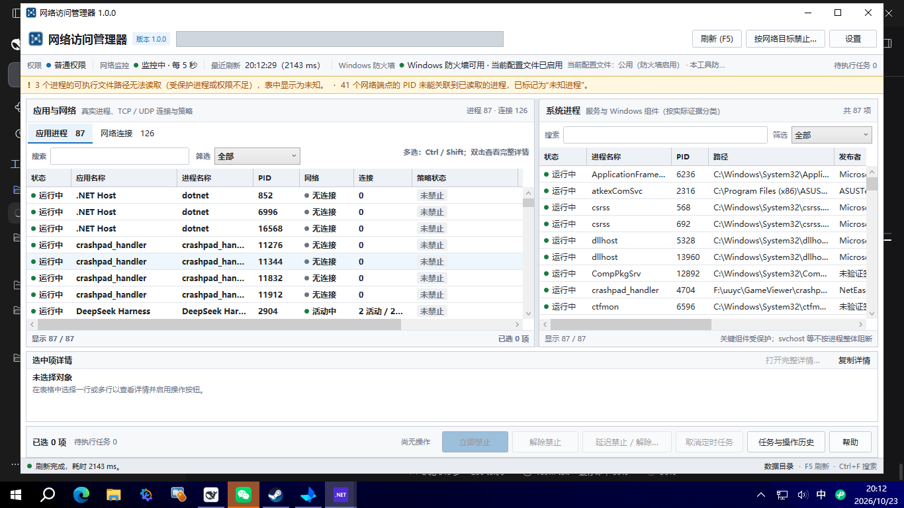
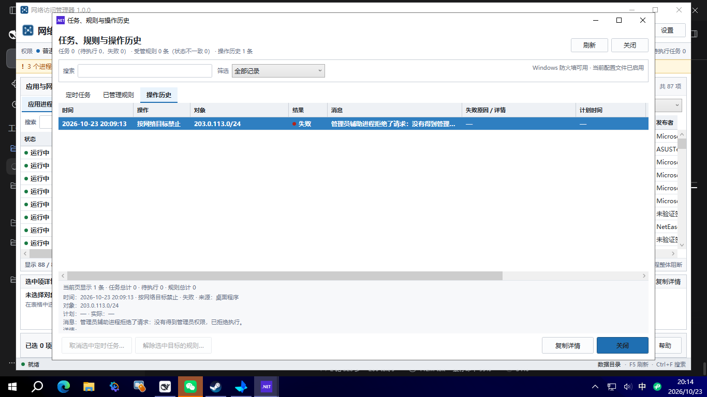

# 网络访问管理器（Network Access Manager）

一个可实际运行的 Windows 桌面网络访问管理工具。界面采用紧凑的单行工具栏、密集数据表格、蓝色整行选择、底部详情与操作栏；所有进程、连接和防火墙状态都来自本机系统接口，不构造演示数据。



> 公开仓库中的截图已隐藏本机数据目录；完整的本地验证截图保存在构建包的 `docs/screenshots` 中。

## 主要能力

- **真实系统信息**：通过 Win32 API 读取进程、服务、TCP/UDP 端点及其所属 PID。无法读取路径、无法关联 PID 的条目会明确显示为“未知”，不会猜测。
- **真实 Windows 防火墙**：只通过 `HNetCfg.FwPolicy2` 创建和删除本工具自己的规则；规则组为 `Network Access Manager 受管规则`，并带身份元数据。不修改全局策略、不关闭防火墙、不删除其他软件的规则。
- **程序阻断**：按可执行文件的完整路径生效，影响该程序的全部实例和所有用户，不是只针对某一个 PID。`svchost.exe`、`lsass.exe`、`csrss.exe`、`wininit.exe`、`winlogon.exe`、`services.exe`、`smss.exe` 及本工具自身被保护。
- **网络目标阻断**：严格校验 IPv4、IPv6、CIDR；不接受域名、端口、多个地址范围或带作用域的 IPv6 地址。CIDR 会规范化主机位。
- **定时控制**：延迟禁止、延迟解除禁止、限时禁止（到时自动解除）。任务写入 Windows 任务计划程序并持久化，关闭程序或重启后仍保留。
- **操作历史**：记录计划时间、实际执行时间、规则核验结果、失败原因、任务状态和取消结果。
- **普通权限界面**：主程序以 `asInvoker` 启动；创建/删除防火墙规则和计划任务时，通过标准 Windows UAC 启动一次性辅助进程。不保存密码、不绕过 UAC、不长期以 SYSTEM 运行界面。
- **界面操作**：搜索、分类筛选、多选、排序、列宽调整、表头排序、完整详情、右键菜单、可调刷新间隔、F5/Ctrl+F、批量逐项结果。

## 系统要求

- Windows 10 22H2 / Windows 11，x64。
- [.NET 10 Desktop Runtime](https://dotnet.microsoft.com/download/dotnet/10.0)（运行发布版所需）；构建需要 .NET 10 SDK（本项目在 10.0.401 上构建）。
- 进行防火墙/计划任务操作时，当前登录账户必须是 `Administrators` 组成员，以便 UAC 对**同一账户**提权。标准用户输入另一个管理员账户的凭据会被辅助进程的 SID 校验拒绝（这是有意的安全边界）。
- 建议解压/安装到当前用户可写的目录。程序默认把 `data` 放在可执行文件旁边；放到 `Program Files` 等只读目录时，普通权限的界面无法写设置和历史，请改用可写目录或设置 `NAM_DATA_DIR`。

## 构建

```powershell
dotnet build NetworkAccessManager.slnx -c Release
```

运行单元测试（不需要管理员）：

```powershell
dotnet test tests/NetworkAccessManager.Tests/NetworkAccessManager.Tests.csproj `
  --filter "Category!=Integration"
```

集成测试默认跳过，只有设置 `NAM_RUN_INTEGRATION_TESTS=1` 且测试进程本身是管理员时才运行。当前自动化环境的 xUnit testhost 不是管理员，因此默认测试运行会跳过这些测试；真实系统验证改由 `tools/SystemVerifier` 完成，结果见 [验证报告](docs/VERIFICATION.md)。

也可以使用脚本：

```powershell
powershell -ExecutionPolicy Bypass -File .\scripts\build.ps1
```

## 运行

直接运行编译后的 apphost：

```powershell
.\src\NetworkAccessManager.App\bin\Release\net10.0-windows\NetworkAccessManager.exe
```

或发布到 `dist` 后运行：

```powershell
powershell -ExecutionPolicy Bypass -File .\scripts\publish.ps1
.\dist\NetworkAccessManager\NetworkAccessManager.exe
```

> 请运行 `NetworkAccessManager.exe`，不要用 `dotnet run` 代替正式运行。正式发布版是 Windows apphost，UAC 辅助进程和计划任务都依赖它的可执行文件路径。

发布脚本使用 framework-dependent 发布；目标机器需要 .NET 10 Desktop Runtime。发布目录就是便携目录，可直接整体复制。

## 使用摘要

1. 在“应用进程”或“网络连接”中选择对象；`Ctrl` / `Shift` 多选。
2. 使用“立即禁止”创建程序或网络目标阻断；“按网络目标禁止…”可直接输入 IP/CIDR。
3. 使用“延迟禁止 / 解除…”安排延迟禁止、延迟解除或限时禁止。
4. “解除禁止”只删除本工具登记且身份核验一致的规则。
5. “任务与操作历史”查看定时任务、受管规则和操作历史；可取消待执行任务。
6. 表头可排序，列宽可拖动；`F5` 刷新，`Ctrl+F` 聚焦搜索框。

## 规则作用范围（重要）

- **程序规则**：作用于完整可执行文件路径，本机所有该路径程序的实例、所有用户、所有防火墙配置文件。不是按 PID 隔离，也不是只影响当前连接。
- **网络目标规则**：作用于远程 IP/网段，影响访问该目标的所有程序，不区分程序，也不限制端口。
- **已有连接**：Windows 防火墙规则主要影响后续连接；已经建立的连接可能短暂保持。程序不会宣称“已立即断开所有连接”。
- **不支持的阻断目标**：域名、URL、端口、进程名通配符、单个 PID 级别的规则都不是本工具的能力范围，界面会拒绝这些输入。
- **外部修改**：其他程序或管理员可以修改/删除本工具的规则；界面会区分“生效中”“已不存在”“被外部修改”和“无法读取”。普通权限无法读取防火墙时，会明确提示状态未知，而不是报成功。
- **关键组件保护**：除硬保护列表外，承载多个服务的 `svchost.exe` 不作为整体程序阻断目标；需要时可针对具体远程地址建立范围受控的目标规则。

## 定时任务与恢复

- 三种模式都创建一个一次性的 Windows 计划任务：`NAM_Task_<guid>`。
- 计划任务使用当前用户的 `InteractiveToken`、`HighestAvailable`、`StartWhenAvailable=true`。
- 关闭界面或重启电脑不会删除待执行任务。计划时间已过而电脑休眠/关机时，Windows 会在恢复并登录后尝试补执行；本工具以**实际执行时间**写入历史，不会把迟到执行伪装成准点执行。
- 如果当前账户没有管理员权限，计划任务在后台无法修改防火墙，会记录“缺少管理员权限”的失败，而不是静默失败。
- 取消任务会先写入逻辑取消状态，再删除 Windows 计划任务；即使系统任务删除失败，后续触发也会看到“已取消”并退出。若选择“取消并解除”，还会移除该任务已创建的规则。
- 计划任务把当前程序的路径写入任务定义。不要把程序放在不可信用户可写的目录，否则计划任务可能被替换的可执行文件利用。



## 权限与安全模型

- UI 以普通用户令牌运行，只有一次性的辅助进程通过 UAC 提权。
- 辅助请求通过 Base64URL JSON 传入；辅助进程校验当前用户 SID、请求协议、创建时间、操作类型和参数。
- 本工具只删除同时匹配自己的规则组、规则名、规则 ID、目标、方向和描述元数据的规则。
- 网络目标规则和程序规则都只由辅助进程创建；UI 不直接调用高权限 COM。
- 没有内核驱动、没有后台常驻 SYSTEM 服务、没有保存管理员密码。

## 数据和日志

默认目录：`<程序目录>\data`

- `state.json`：规则、任务和历史；带备份文件并采用原子替换。
- `settings.json`：刷新间隔等界面设置。
- `logs\`：按进程/日期滚动的日志。
- `results\`：一次性辅助进程返回的结果文件。

可通过绝对路径环境变量覆盖：

```powershell
$env:NAM_DATA_DIR = "C:\Users\me\AppData\Local\NetworkAccessManagerData"
```

## 验证与已知限制

- 112 个不依赖管理员权限的自动化单元测试通过（构建 0 警告）。
- 真实 Windows 防火墙创建、核验、删除，以及真实计划任务注册/查询/删除均已执行；延迟禁止、延迟解除、限时禁止自动恢复、取消、取消并解除的 Core 执行路径全部通过。详见 [验证报告](docs/VERIFICATION.md) 和 [原始系统验证输出](docs/verification-system-verifier.txt)。
- 当前自动化环境没有可交互的 UAC 同意桌面。一次真实 UI 操作中，辅助进程被环境以非管理员令牌启动，它按设计拒绝请求；界面显示“请求失败”，没有创建任何规则，并向历史写入失败事件。因此**“用户单击 UAC 是/否”的完整交互没有被本环境验证**，代码对 `ERROR_CANCELLED (1223)` 有明确处理路径。
- “延迟禁止/自动解除”的真实墙钟触发等待没有在本次自动化中完整跑过；验证使用真实任务注册 + 真实 Core 执行器手动触发。任务计划程序注册、查询、删除本身是真实执行的。
- 进程/连接的可见范围取决于 Windows 会话、权限和系统保护进程。工具不会因为看不到而伪造数据；无法读取时显示“未知”。
- 数字签名只检测嵌入的 Authenticode 签名。Windows 自带的目录签名文件可能显示“未验证签名”，这不等于未签名或恶意。
- 没有内核级网络过滤、域名解析目标、按端口或按单连接阻断；没有自动安装程序。
- 发布版是 framework-dependent；目标机需要 .NET 10 Desktop Runtime。

## 目录结构

```
src/NetworkAccessManager.Core/      系统枚举、防火墙、校验、调度、状态与操作核心
src/NetworkAccessManager.App/       WPF 界面、UAC 客户端、UI 服务
tests/NetworkAccessManager.Tests/   xUnit 单元/伪集成测试
tools/SystemVerifier/               真实系统验证控制台（测试用，需要提权）
docs/                               截图与验证报告
scripts/                            构建、发布脚本
```

## 截图

| 界面 | 文件 |
|---|---|
| 主窗口（已隐藏数据目录） | [main-window.png](docs/screenshots/main-window.png) |
| 多选 | [multi-select.png](docs/screenshots/multi-select.png) |
| 网络目标 | [network-target.png](docs/screenshots/network-target.png) |
| 网络目标校验失败 | [network-target-invalid.png](docs/screenshots/network-target-invalid.png) |
| 任务历史 | [task-history.png](docs/screenshots/task-history.png) |
| 帮助 | [help-window.png](docs/screenshots/help-window.png) |
| 无权限操作结果 | [uac-result-failure.png](docs/screenshots/uac-result-failure.png) |

> 含本机进程路径、连接地址和设置路径的截图只保留在本地构建包中，不进入公开仓库。以下截图路径仍可在本地 `dist` 包内查看：`process-selected.png`、`connection-tab.png`、`schedule-dialog.png`、`block-dialog.png`、`details.png`、`settings.png`。
